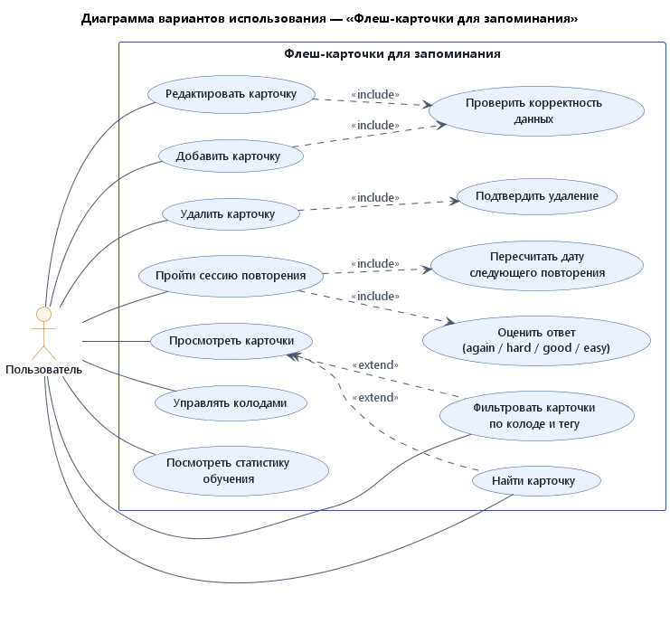
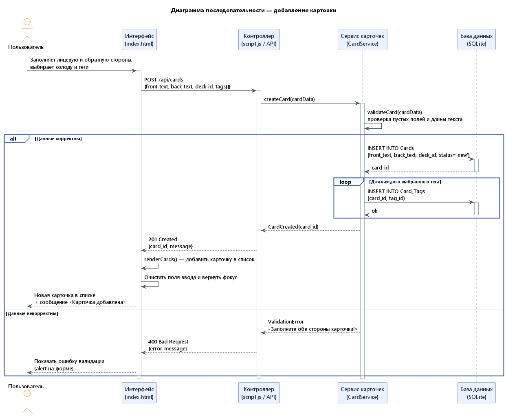
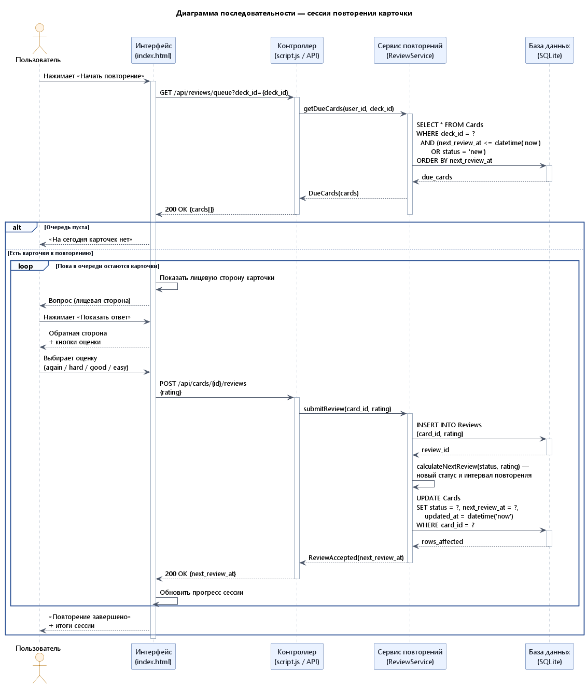
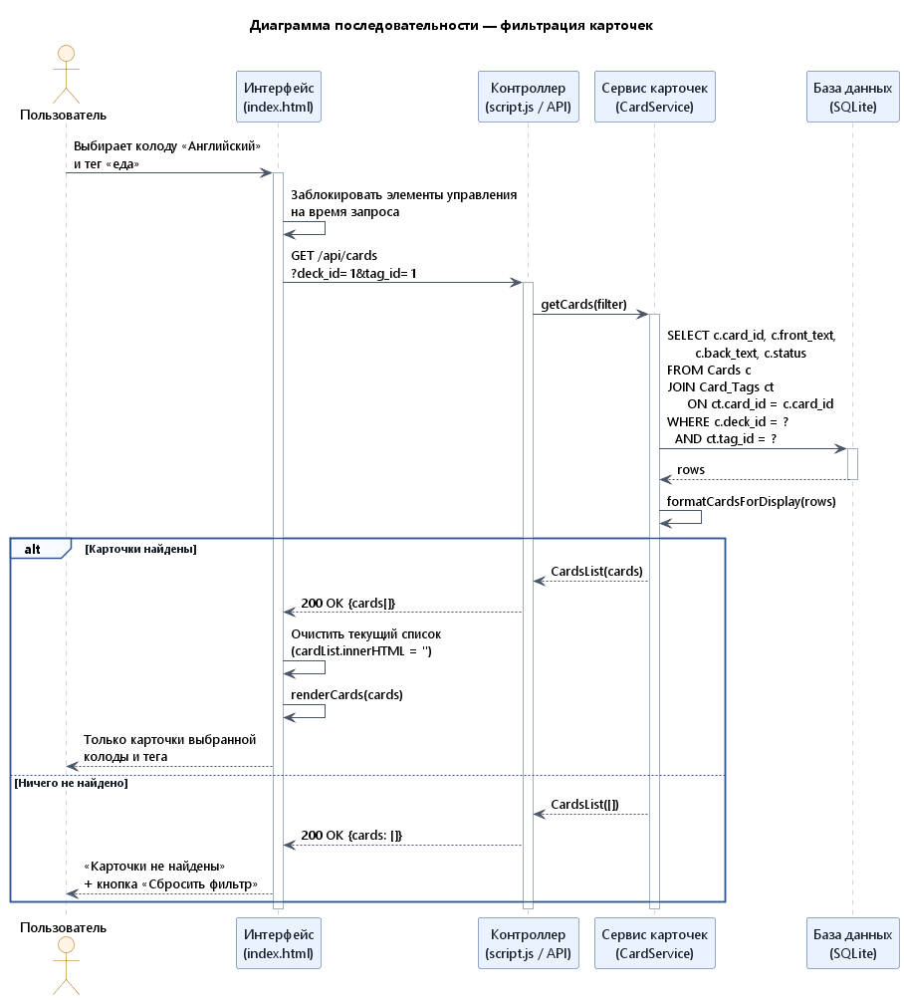
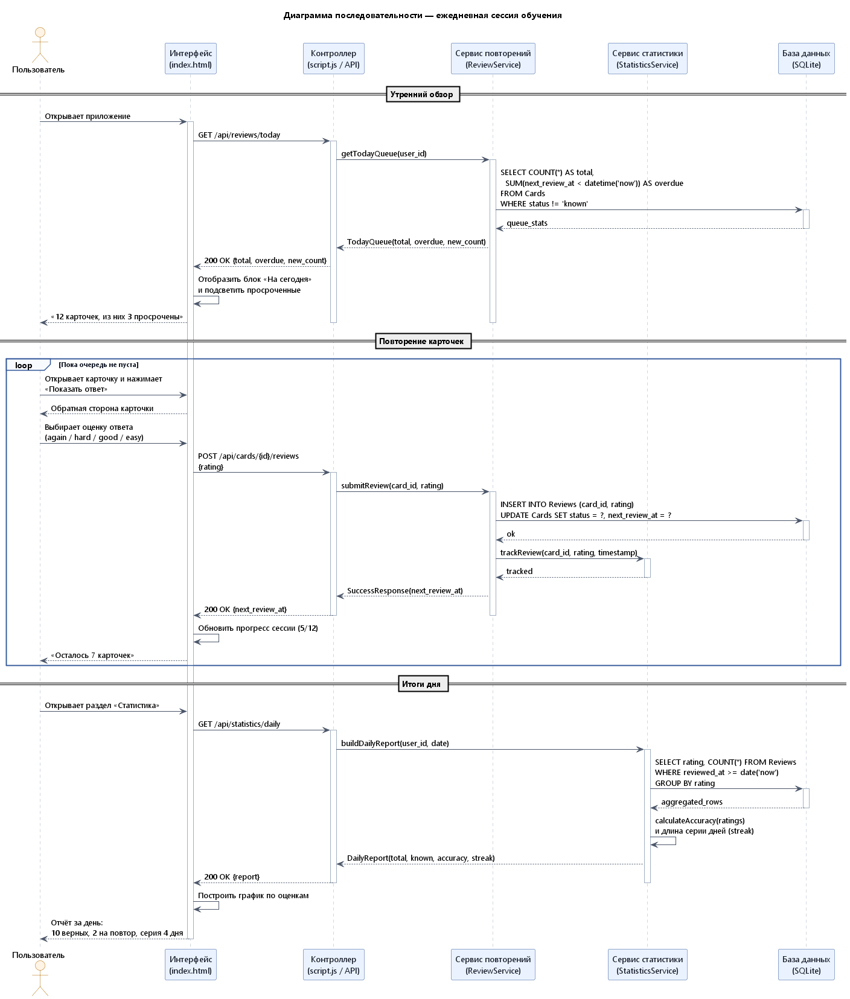

# Диаграммы поведения системы

Документация к лабораторной работе №5 «Моделирование поведения: Use Case и диаграммы последовательности».

Приложение: **«Флеш-карточки для запоминания»** (Anki-подобное) — пользователь создаёт карточки «вопрос → ответ», раскладывает их по колодам, помечает тегами и проходит сессии повторения по алгоритму интервального повторения (SRS).

Все диаграммы описаны кодом PlantUML (`.puml`) и отрендерены в PNG. Диаграммы построены по фактической схеме БД проекта (`database/schema.sql`): `Users`, `Decks`, `Cards`, `Reviews`, `Tags`, `Card_Tags`.

## Структура папок

```
docs/
├── use_case/
│   ├── use_case_diagram.puml     # исходник PlantUML
│   └── use_case_diagram.png      # готовое изображение
└── behavior/
    ├── README.md                 # этот документ
    └── sequence/
        ├── create_card_sequence.puml / .png
        ├── review_card_sequence.puml / .png
        ├── filter_cards_sequence.puml / .png
        └── daily_session_sequence.puml / .png
```

---

## 1. Диаграмма вариантов использования (Use Case)



Файлы: [`use_case_diagram.puml`](../use_case/use_case_diagram.puml) · `use_case_diagram.png`

### Акторы

| Актор | Роль |
|---|---|
| **Пользователь** | Единственный актор системы: создаёт колоды и карточки, проходит повторения, смотрит статистику. Работает со своими данными (в схеме БД — `Users.user_id`). |

### Границы системы

Рамка «Флеш-карточки для запоминания» — граница приложения. Всё, что внутри, реализует система; актор находится снаружи и только инициирует сценарии.

### Основные варианты использования

| ID | Вариант использования | Описание |
|---|---|---|
| UC1 | Добавить карточку | Создание карточки: лицевая сторона (`front_text`), обратная (`back_text`), колода (`deck_id`), теги |
| UC2 | Просмотреть карточки | Вывод списка карточек текущей колоды |
| UC3 | Редактировать карточку | Изменение текста сторон, колоды и тегов существующей карточки |
| UC4 | Удалить карточку | Удаление карточки из колоды |
| UC5 | Пройти сессию повторения | Последовательный показ карточек, срок повторения которых наступил |
| UC6 | Оценить ответ | Выставление оценки `again / hard / good / easy` (в схеме БД — `Reviews.rating`) |
| UC7 | Фильтровать карточки по колоде и тегу | Отбор карточек по `deck_id` и `tag_id` |
| UC8 | Найти карточку | Поиск по тексту лицевой и обратной стороны |
| UC9 | Управлять колодами | Создание, переименование и удаление колод (`Decks`) |
| UC10 | Посмотреть статистику обучения | Отчёт по количеству повторений, доле верных ответов, серии дней |

### Связи `include` и `extend`

**`include`** — обязательное поведение, всегда выполняется вместе с базовым вариантом:

| Базовый | Включаемый | Смысл |
|---|---|---|
| Добавить карточку | Проверить корректность данных | Нельзя сохранить карточку с пустой стороной — проверка выполняется всегда |
| Редактировать карточку | Проверить корректность данных | Те же правила валидации при изменении |
| Удалить карточку | Подтвердить удаление | Перед удалением система запрашивает подтверждение (в текущем коде — `confirm('Удалить эту карточку?')`) |
| Пройти сессию повторения | Оценить ответ | Сессия не может завершиться без оценки |
| Пройти сессию повторения | Пересчитать дату следующего повторения | После каждой оценки пересчитываются `Cards.status` и `Cards.next_review_at` |

**`extend`** — необязательное расширение, выполняется только при определённом условии:

| Базовый | Расширяющий | Условие |
|---|---|---|
| Просмотреть карточки | Фильтровать карточки по колоде и тегу | Пользователь выбрал колоду или тег |
| Просмотреть карточки | Найти карточку | Пользователь ввёл поисковый запрос |

---

## 2. Диаграммы последовательности

Четыре сценария покрывают полный цикл работы с приложением: создание → повторение → выборка → ежедневная сессия.

Обозначения: `alt` — альтернативные ветки (успех / ошибка), `loop` — циклическое повторение действий, `== раздел ==` — фаза бизнес-процесса.

### 2.1. Добавление карточки



Файлы: [`create_card_sequence.puml`](sequence/create_card_sequence.puml) · [`create_card_sequence.png`](sequence/create_card_sequence.png)

**Цель:** показать путь данных от формы до таблиц `Cards` и `Card_Tags` с обязательной валидацией.

**Участники:** Пользователь → Интерфейс (`index.html`) → Контроллер (`script.js` / API) → Сервис карточек (`CardService`) → БД (SQLite).

**Ход сценария:**

1. Пользователь заполняет обе стороны карточки, выбирает колоду и теги.
2. Интерфейс отправляет `POST /api/cards` с телом `{front_text, back_text, deck_id, tags[]}`.
3. `CardService.createCard()` вызывает `validateCard()` — проверка пустых полей и длины текста (в текущей версии приложения это `alert('Заполните обе стороны карточки!')`).
4. **Данные корректны:** `INSERT INTO Cards` со статусом `new`, затем в цикле `INSERT INTO Card_Tags` для каждого тега. Возвращается `card_id`, интерфейс перерисовывает список (`renderCards()`), очищает поля и возвращает фокус.
5. **Данные некорректны:** `ValidationError` → `400 Bad Request` → пользователь видит сообщение об ошибке, карточка не создаётся.

**Связь со схемой БД:** `Cards.deck_id` — внешний ключ на `Decks`; `Cards.status` по умолчанию `new`; связь «многие ко многим» карточек и тегов хранится в `Card_Tags`.

### 2.2. Сессия повторения карточки (SRS)



Файлы: [`review_card_sequence.puml`](sequence/review_card_sequence.puml) · [`review_card_sequence.png`](sequence/review_card_sequence.png)

**Цель:** описать ключевой процесс приложения — интервальное повторение: выбор карточек «на сегодня», показ, оценка и пересчёт следующей даты.

**Участники:** Пользователь → Интерфейс → Контроллер → Сервис повторений (`ReviewService`) → БД.

**Ход сценария:**

1. Пользователь нажимает «Начать повторение»; интерфейс запрашивает очередь: `GET /api/reviews/queue?deck_id={id}`.
2. `ReviewService.getDueCards()` выбирает карточки, у которых `next_review_at <= datetime('now')` или `status = 'new'`.
3. Если очередь пуста — пользователь видит сообщение «На сегодня карточек нет».
4. Иначе в цикле: показ лицевой стороны → «Показать ответ» → обратная сторона и кнопки оценки → выбор `again / hard / good / easy`.
5. Оценка отправляется `POST /api/cards/{id}/reviews`; `ReviewService.submitReview()`:
   - пишет запись в `Reviews (card_id, rating)`;
   - вызывает `calculateNextReview(status, rating)` — алгоритм рассчитывает новый статус (`new → learning → review → known`) и интервал до следующего показа;
   - обновляет `Cards.status`, `Cards.next_review_at`, `Cards.updated_at`.
6. Интерфейс обновляет прогресс сессии; после последней карточки показывает итоги.

**Связь со схемой БД:** `Reviews` хранит историю всех ответов, `Cards.next_review_at` — дату следующего показа (по ней есть индекс `idx_cards_next_review_at`, поэтому выборка очереди не деградирует с ростом базы).

### 2.3. Фильтрация карточек по колоде и тегу



Файлы: [`filter_cards_sequence.puml`](sequence/filter_cards_sequence.puml) · [`filter_cards_sequence.png`](sequence/filter_cards_sequence.png)

**Цель:** показать механизм выборки с фильтрами и поведение интерфейса при пустом результате.

**Участники:** Пользователь → Интерфейс → Контроллер → Сервис карточек → БД.

**Ход сценария:**

1. Пользователь выбирает колоду «Английский» и тег «еда»; элементы управления блокируются на время запроса.
2. `GET /api/cards?deck_id=1&tag_id=1` → `CardService.getCards(filter)`.
3. SQL-запрос соединяет `Cards` и `Card_Tags` и фильтрует по колоде и тегу.
4. **Карточки найдены:** список форматируется, интерфейс очищает текущий список (`cardList.innerHTML = ''`) и перерисовывает его.
5. **Ничего не найдено:** возвращается пустой массив, пользователь видит «Карточки не найдены» и кнопку «Сбросить фильтр».

**Связь со схемой БД:** фильтрация использует индексы `idx_cards_deck_id` и первичный ключ `Card_Tags (card_id, tag_id)`.

### 2.4. Ежедневная сессия обучения (комплексный сценарий)



Файлы: [`daily_session_sequence.puml`](sequence/daily_session_sequence.puml) · [`daily_session_sequence.png`](sequence/daily_session_sequence.png)

**Цель:** связать три процесса в один бизнес-процесс «типичный день пользователя».

**Участники:** Пользователь → Интерфейс → Контроллер → Сервис повторений → Сервис статистики (`StatisticsService`) → БД.

**Фазы:**

1. **Утренний обзор.** `GET /api/reviews/today` → `getTodayQueue()` считает общее количество карточек к повторению и число просроченных (`next_review_at < datetime('now')`). Интерфейс показывает «12 карточек, из них 3 просрочены».
2. **Повторение карточек.** Цикл по очереди: каждая оценка пишется в `Reviews`, обновляет `Cards`, затем передаётся в `StatisticsService.trackReview()` для накопления статистики; прогресс сессии обновляется после каждой карточки.
3. **Итоги дня.** `GET /api/statistics/daily` → `buildDailyReport()` агрегирует `Reviews` по оценкам за текущую дату, считает долю верных ответов и длину серии дней (`streak`); интерфейс строит график.

**Отличие от сценария 2.2:** здесь показано взаимодействие двух сервисов (`ReviewService` и `StatisticsService`) и полный цикл «обзор → работа → аналитика», а не отдельная операция повторения.

---

## 3. Соответствие диаграмм схеме базы данных

| Сущность БД | Где используется на диаграммах |
|---|---|
| `Users` | Актор «Пользователь», параметр `user_id` в запросах очереди и статистики |
| `Decks` | Выбор колоды при создании карточки и фильтрации |
| `Cards` | Создание, просмотр, фильтрация, повторение (`status`, `next_review_at`) |
| `Reviews` | Запись оценки в сценариях 2.2 и 2.4 |
| `Tags`, `Card_Tags` | Присвоение тегов при создании и фильтрация по тегу |

## 4. Инструменты

| Инструмент | Назначение |
|---|---|
| **PlantUML** | Кодовое представление всех диаграмм, хранение в Git, единый стиль |
| **Graphviz (dot)** | Раскладка Use Case диаграммы (PlantUML использует его автоматически) |
| **PNG** | Готовые изображения для отчёта и Wiki |

### Как перегенерировать PNG

Из корня репозитория (нужны Java 8+ и `plantuml.jar`):

```powershell
java -jar plantuml.jar -charset UTF-8 -tpng docs/use_case/use_case_diagram.puml
java -jar plantuml.jar -charset UTF-8 -tpng docs/behavior/sequence/*.puml
```

Альтернативы: расширение **PlantUML** для VS Code (`Alt+D` — предпросмотр, экспорт PNG/SVG) или онлайн-редактор plantuml.com. Параметр `-charset UTF-8` обязателен, иначе русский текст в подписях превратится в «кракозябры».

### Стиль

Все диаграммы используют единые правила оформления: шрифт Segoe UI, синие варианты использования (`#EAF2FF` / `#2F5597`), оранжевый актор (`#FFF4E5` / `#B26B00`), без теней. Это задано блоком `skinparam` в начале каждого `.puml`-файла — при изменении стиля достаточно поправить одно место в каждом файле.
